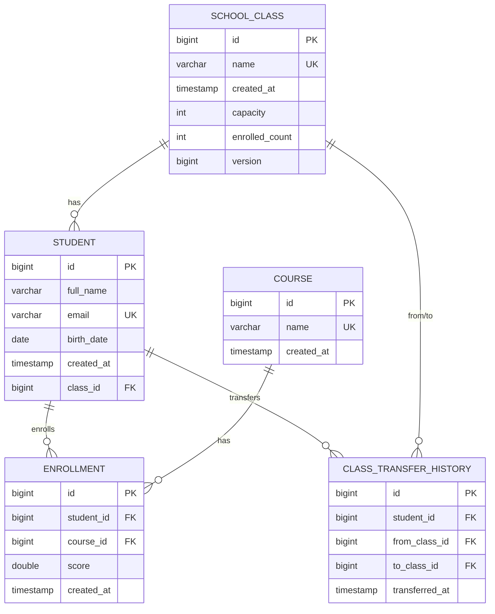

# Student Management API

API quản lý sinh viên (Student Management) xây dựng bằng Spring Boot 4, cung cấp
CRUD cho sinh viên, lớp học, khóa học, ghi danh (enrollment) và các thống kê điểm
số liên quan, theo kiến trúc Controller → Service → Repository → Database.

## Mục tiêu

- Xây dựng REST API quản lý thông tin sinh viên (CRUD).
- Thực hành kiến trúc layered (Controller → Service → Repository → Database) với Spring Boot.
- Thực hành thiết kế và tương tác cơ sở dữ liệu quan hệ (PostgreSQL) qua Spring Data JPA.

## Tech Stack

- **Ngôn ngữ**: Java 25
- **Framework**: Spring Boot 4.1.2, Spring MVC
- **Data access**: Spring Data JPA + Hibernate, Flyway (migration)
- **Database**: PostgreSQL 16 (container qua `compose.yaml`)
- **Build tool**: Maven (Maven Wrapper)
- **Mapping**: MapStruct + Lombok
- **API**: RESTful API, lỗi trả về dạng `ProblemDetail`

## Kiến trúc

```
Controller  →  Service  →  Repository  →  Database
```

- **Controller** (`controller/`): nhận request, validate (`@Valid`), gọi Service, trả response.
- **Service** (`service/`): business logic (kiểm tra trùng dữ liệu, capacity lớp, optimistic locking...).
- **Repository** (`repository/`): `JpaRepository`, thao tác dữ liệu.
- **Entity** (`entity/`): ánh xạ bảng DB.
- **DTO** (`dto/`): request/response dạng `record`.
- **Mapper** (`mapper/`): MapStruct, map entity ↔ DTO.
- **Exception** (`exception/`): custom exception + `GlobalExceptionHandler`.

## Cấu trúc thư mục

```
student-management-api/
├── compose.yaml                  # Postgres container cho môi trường dev
├── sql/                           # Track học SQL song song (không tự đồng bộ với schema thật)
├── docs/
│   └── ai-review-log.md
└── student-api/                  # Module Spring Boot chính
    ├── mvnw / mvnw.cmd
    ├── pom.xml
    └── src/
        ├── main/
        │   ├── java/com/thienlv/student_api/
        │   │   ├── controller/
        │   │   ├── service/
        │   │   ├── repository/
        │   │   ├── entity/
        │   │   ├── dto/
        │   │   ├── mapper/
        │   │   ├── exception/
        │   │   └── filter/
        │   └── resources/
        │       ├── application.yml
        │       ├── application-dev.yml
        │       ├── application-prod.yml
        │       └── db/migration/   # Flyway V1..V5
        └── test/
```

## Yêu cầu môi trường

- JDK 25
- Docker Desktop (chạy Postgres qua `compose.yaml`, và chạy Testcontainers cho test)
- IDE: IntelliJ IDEA (khuyến nghị)

## Cài đặt & chạy dự án

```bash
# Clone dự án
git clone <repository-url>
cd student-management-api

# 1. Khởi động Postgres (từ thư mục gốc repo)
docker compose up -d

# 2. Build & chạy ứng dụng (từ thư mục student-api/)
cd student-api
./mvnw clean install
./mvnw spring-boot:run -Dspring-boot.run.profiles=dev
```

Trên Windows dùng `mvnw.cmd` thay cho `./mvnw`.

> Không có profile mặc định nào được kích hoạt sẵn (`spring.profiles.active` không
> đặt trong `application.yml`) — phải truyền `-Dspring-boot.run.profiles=dev` khi
> chạy với Postgres thật, nếu không sẽ không có `datasource` nào được cấu hình.

Ứng dụng chạy ở `server.port=8081` → base URL mặc định: `http://localhost:8081`.

### Chạy test

```bash
cd student-api
./mvnw test
```

Một số test dùng Testcontainers (tự pull image `postgres:16-alpine`) nên cần
Docker Desktop đang chạy; `StudentApiApplicationTests` (profile `dev`) cần
container Postgres từ `compose.yaml` đang chạy ở cổng 5433.

## Cấu hình database

Container Postgres (`compose.yaml`, service `postgres`, image `postgres:16-alpine`):

| Biến            | Giá trị       |
|-----------------|---------------|
| `POSTGRES_DB`       | `student_api` |
| `POSTGRES_USER`     | `student_api` |
| `POSTGRES_PASSWORD` | `student_api` |
| Port map            | `5433:5432`   |

Profile `dev` (`application-dev.yml`) trỏ tới:

```yaml
spring:
  datasource:
    url: jdbc:postgresql://localhost:5433/student_api
    username: student_api
    password: student_api
  jpa:
    hibernate:
      ddl-auto: validate   # Hibernate chỉ validate, không tự tạo/sửa bảng
```

Schema được quản lý qua **Flyway** (`src/main/resources/db/migration/`), chạy tự
động khi ứng dụng khởi động:

| Migration | Nội dung |
|-----------|----------|
| `V1__init.sql` | Tạo bảng `classes`, `courses`, `students`, `enrollments` |
| `V2__add_indexes.sql` | Index cho `students.class_id`, `enrollments(course_id, student_id)` |
| `V3__class_transfer_history.sql` | Bảng `class_transfer_history` (lịch sử chuyển lớp) |
| `V4__class_capacity.sql` | Thêm `capacity`, `enrolled_count` vào `classes` |
| `V5__class_version.sql` | Thêm `version` vào `classes` (optimistic locking) |

> `sql/` là track học SQL song song, **không** đồng bộ tự động với schema thật —
> entity Java + Flyway migration mới là nguồn sự thật cho schema.

## ERD



- `Student` → `SchoolClass`: nhiều-một, bắt buộc (`class_id NOT NULL`).
- `Enrollment` là bảng trung gian Student ↔ Course (many-to-many qua entity
  thường, không dùng `@ManyToMany`), unique theo `(student_id, course_id)`.
- `ClassTransferHistory` ghi lại mỗi lần sinh viên đổi lớp (`from_class_id` → `to_class_id`).
- `SchoolClass.version` dùng cho `@Version` (optimistic locking) khi nhiều
  request cùng thêm sinh viên vào lớp.

## API Endpoints

Base URL: `http://localhost:8081`

### Students (`/api/students`)

| Method | Endpoint | Mô tả |
|--------|----------|-------|
| GET    | `/api/students` | Danh sách sinh viên, có phân trang (`Pageable`, mặc định `size=20&sort=id`) + filter `name`, `minAge`, `maxAge` |
| GET    | `/api/students/{id}` | Chi tiết 1 sinh viên |
| GET    | `/api/students/without-course` | Sinh viên chưa đăng ký khóa học nào |
| GET    | `/api/students/{id}/courses` | Danh sách khóa học + điểm của 1 sinh viên |
| POST   | `/api/students` | Tạo sinh viên mới (`201` + header `Location`) |
| PUT    | `/api/students/{id}` | Cập nhật thông tin sinh viên |
| PUT    | `/api/students/{id}/class/{classId}` | Chuyển lớp cho sinh viên (ghi lịch sử) |
| DELETE | `/api/students/{id}` | Xóa sinh viên (`204`) |

### Classes (`/api/classes`)

| Method | Endpoint | Mô tả |
|--------|----------|-------|
| GET    | `/api/classes` | Danh sách tất cả lớp |
| GET    | `/api/classes/{id}` | Chi tiết 1 lớp |
| GET    | `/api/classes/{id}/students` | Danh sách sinh viên của 1 lớp |
| POST   | `/api/classes` | Tạo lớp mới (`201` + `Location`) |
| POST   | `/api/classes/{id}/students` | Thêm sinh viên vào lớp (kiểm tra capacity, optimistic lock) |
| PUT    | `/api/classes/{id}` | Cập nhật lớp |
| DELETE | `/api/classes/{id}` | Xóa lớp (`204`) |

### Courses (`/api/courses`)

| Method | Endpoint | Mô tả |
|--------|----------|-------|
| GET    | `/api/courses` | Danh sách tất cả khóa học |
| GET    | `/api/courses/{id}` | Chi tiết khóa học |
| GET    | `/api/courses/{id}/average-score` | Điểm trung bình của khóa học |
| GET    | `/api/courses/{id}/top-scores` | Top điểm cao trong khóa học (có rank) |
| GET    | `/api/courses/{id}/score-vs-average` | So sánh điểm từng sinh viên với điểm trung bình |
| POST   | `/api/courses` | Tạo khóa học mới (`201` + `Location`) |
| PUT    | `/api/courses/{id}` | Cập nhật khóa học |
| DELETE | `/api/courses/{id}` | Xóa khóa học (`204`) |

### Enrollments (`/api/enrollments`)

| Method | Endpoint | Mô tả |
|--------|----------|-------|
| POST   | `/api/enrollments` | Ghi danh sinh viên vào khóa học kèm điểm (`201` + `Location`) |

### Format lỗi

Toàn bộ lỗi trả về dạng `ProblemDetail` qua `GlobalExceptionHandler`:

| Trường hợp | HTTP status |
|------------|-------------|
| `NotFoundException` | 404 |
| `DuplicateEmailException`, `DuplicateClassNameException`, `DuplicateCourseNameException`, `DuplicateEnrollmentException`, `ClassFullException` | 409 |
| Optimistic lock conflict (2 request cùng ghi vào 1 lớp) | 409 |
| Lỗi validate (`@Valid`) | 400, kèm property `errors` (map field → message) |
| Route không tồn tại | 404 |
| Lỗi khác | 500 (đã log, không lộ message/stacktrace gốc) |

## Roadmap

Dự án được phát triển theo lộ trình học Spring Boot & Database, đã hoàn thành:
thiết kế entity, CRUD cơ bản, validation & exception handling, quan hệ giữa các
bảng, phân trang/tìm kiếm, Flyway migration, xử lý N+1 (`@EntityGraph`),
`@Transactional`, optimistic locking (`@Version`) cho capacity lớp.

## Quy tắc trong tháng

- **Quy tắc vàng**: không commit dòng code nào mà bạn không giải thích được. Khi AI viết, hỏi lại "vì sao" cho đến khi hiểu, hoặc xóa đi tự viết.
- **Tuần 3**: không mở AI để viết code. Kẹt quá 30 phút thì chỉ nhờ AI giải thích thông báo lỗi, không xin code sửa sẵn.
- **Nhật ký review AI** (từ tuần 4): mỗi lần AI viết sai (N+1, quên `@Transactional`, nuốt exception, dùng API cũ của Spring Boot 3…) thì ghi một dòng. Mục tiêu cuối tháng: ít nhất 10 lỗi.
- **DB song song**: mỗi buổi 45–60 phút, tự gõ, không AI (trừ việc sinh dữ liệu mẫu). Chi tiết ở bảng "DB song song" dưới mỗi tuần.
- **30 phút cuối buổi thứ Sáu**: trả lời câu hỏi tự kiểm tra của tuần, cập nhật nhật ký, đẩy code lên GitHub và gắn tag `week-N`.

## Đóng góp

Đây là dự án cá nhân phục vụ mục đích học tập/thực hành. Các issue và pull request đóng góp (nếu có) sẽ được xem xét trực tiếp.
